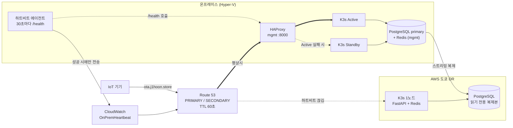

# OTA 배포 플랫폼: Ansible IaC + 멀티 K3s(Active-Standby) + 도쿄 DR

대규모 IoT 기기를 운영할 때 생기는 **단일 장애점, DB 부하, 빌드 I/O 지연**을 인프라와 아키텍처 수준에서 줄이기 위해 만든 무중단 OTA(펌웨어 무선 업데이트) 배포 플랫폼입니다.
온프레미스(Hyper-V + Multipass) 위에 K3s 클러스터 2개(Active/Standby)를 두고, 온프레미스 전체가 죽는 경우를 위해 AWS 도쿄에 DR(재해 복구) 환경을 둔 하이브리드 구조입니다.

> **범위**: 홈랩 규모의 실험 환경입니다. 이 문서의 수치는 모두 `docs/evidence/`의 원본 로그에서 나온 값이며, 측정 횟수(n)와 증명하지 못한 범위를 함께 적었습니다. 증거가 없는 항목은 수치를 적지 않았습니다.

## 1. 풀려던 문제와 결과

| 병목 | 접근 | 측정 결과 | 근거 |
|---|---|---|---|
| **단일 장애점** (클러스터) | mgmt의 HAProxy가 `/health`로 Active를 감시하고, 실패하면 Standby로 절체 | 절체 시간(RTO) 중앙값 **1.77초**(`inter=500ms`, n=10), 절체 구간의 실패 요청 중앙값 16.5건(0.1초 간격 폴링 기준) | [failover-inter500](docs/evidence/failover-inter500/) |
| **단일 장애점** (온프레미스 전체) | 하트비트가 끊기면 Route 53이 DNS를 도쿄 DR로 전환 | DNS 전환 **약 5.2~6.4분**(314~381초, 6회), 전환 후 DR이 요청 처리 | [dns-failover](docs/evidence/dns-failover/), [dr-e2e*](docs/evidence/dr-e2e/) |
| **DB 부하** | 최신 펌웨어 조회를 Redis에 캐시(TTL 300초), 기기 상태 수집을 SQS로 분리해 DB 쓰기를 평탄화, DR 동안의 보고는 Redis 큐에 보관 | 상태 수집 유실 검증 1회(소비자 중단 중 3건 발행 → 복구 후 3건 모두 반영) | [status-ingest](docs/evidence/status-ingest/loss-test.md) |
| **빌드 I/O 지연** | Jenkins 파이프라인에서 RAM 디스크와 디스크 I/O를 5회 중앙값으로 비교하는 벤치마크 단계 | **정량 결과는 이 레포에 보관되어 있지 않음**(Jenkins 빌드 로그에만 있음) | `jenkins/Jenkinsfile` 2단계 |

이 밖에 API 롤아웃(배포 교체) 시간을 25.1초에서 6.5초로 줄였습니다(이미지 사전 빌드, SHA 고정, `maxSurge 2`, 빠른 readiness). 이 수치는 커밋 `10f96bf`의 메시지에 기록된 값이고 원본 로그는 레포에 없습니다.

## 2. 아키텍처



실선(굵음)은 평상시 요청 경로, 점선은 장애 시 경로나 확인 호출입니다. 펌웨어 배포(Jenkins, S3+CloudFront)와 기기 상태 수집(IoT Core, SQS)은 [상태 수집 다이어그램](docs/architecture.md#4-기기-상태-수집)과 아래 설명을 참고하세요.

핵심 설계는 **두 단계 방어**입니다.

1. **클러스터 수준(초 단위)**: Active 클러스터가 죽어도 HAProxy가 Standby로 돌려서 `/health`가 계속 200이므로 하트비트가 이어지고 DNS는 바뀌지 않습니다.
2. **사이트 수준(분 단위)**: Active와 Standby가 모두 죽거나 HAProxy/호스트가 죽어 `/health`가 실패하면 하트비트가 끊기고, Route 53이 DNS를 DR로 돌립니다.

자세한 구성과 설계 결정은 [docs/architecture.md](docs/architecture.md)를 참고하세요.

## 3. 측정 결과 요약

| 실험 | 조건 | 결과 | n |
|---|---|---|---|
| HAProxy 절체 (`inter=1000ms`) | Active 장애 주입 | RTO 중앙값 3.65초 (3.14~4.06) | 10 |
| HAProxy 절체 (`inter=500ms`, **채택값**) | 동일 | RTO 중앙값 1.77초 (1.61~1.93), 복귀 중앙값 1.07초 | 10 |
| HAProxy 절체 (`inter=250ms`) | 동일 | RTO 중앙값 0.96초 (0.81~1.02), 복귀 중앙값 0.57초 | 10 |
| DNS 전환 (에이전트 중단) | 하트비트 서비스 중단 | 권한 서버 기준 중앙값 333초 (314~381) | 3 |
| DR 종단 (에이전트 중단) | 전환 후 요청을 DR로 전송 | 전환 343초, DR 처리 10/10, 보고 큐 보관 | 1 |
| DR 종단 (HAProxy 중지) | 에이전트는 정상, `/health`만 실패 | 전환 342초, DR 처리 9/10 | 1 |
| DR 종단 (앱 전부 중단) | Active+Standby API 파드 0 | 전환 324초, DR 처리 7/10 | 1 |
| DNS 플래핑 | 2시간 동안 15초 간격 조회, Jenkins 빌드 부하 | PRIMARY 이탈 0 (표본 478) | 1 |
| DR 큐 반영 | DR에서 쌓인 보고 2건 | 신규 반영 2, 중복 0, 큐 0 | 1 |

`DR 처리 N/10`에서 나머지는 공개 리졸버(8.8.8.8)가 전환 직후 옛 값(온프레미스 IP)을 안내한 경우(`stale`)입니다. 전파 지연이며 DR의 실패가 아닙니다.
실험 방법과 한계는 [docs/evidence/README.md](docs/evidence/README.md)에 있습니다.

## 4. 증명하지 못한 것 (한계)

- **실제 인터넷 트래픽**: 온프레미스는 외부에서 도달할 수 없는 랩이라, DNS 응답이 DR로 바뀌고 그 이름으로 보낸 요청을 DR이 처리하는 것까지만 확인했습니다. 장애 전에 PRIMARY로 실제 요청이 들어갔다는 검증은 없습니다.
- **측정 횟수**: DR 종단 시나리오는 각각 1회입니다. 분포나 중앙값을 주장할 수 없습니다.
- **알람 경로**: 장애 중 CloudWatch 알람은 `OK`로 남았고 Route 53 헬스체크가 먼저 `Unhealthy`가 됐습니다. 원인을 "Route 53이 지표 부재를 직접 평가한다"로 추정하지만 AWS 문서로 확인하지는 않았습니다.
- **RPO(데이터 손실 허용량)**: DB 복제는 비동기이고 복제 지연을 측정하지 않았습니다.
- **복구 후 데이터 정합성은 수동**: DR에서 쌓인 보고는 `scripts/drain-dr-queue.py`를 실행해야 원본 DB에 반영됩니다. 자동화되어 있지 않습니다.
- **기기 인증**: `/ota/check`, `/ota/report`에는 기기 인증이 없습니다(`/ota/publish`, `/ota/status`만 API 키 보호).
- **DR 규모**: 단일 노드이며 부하 시험은 하지 않았습니다.
- **DB 부하와 빌드 I/O**: 위 표에 적은 대로 정량 증거가 레포에 없습니다.

## 5. 저장소 구조

```
ansible/              # 온프레미스 구성(site.yml), DR 구성(dr.yml), 롤(control_tower, k3s, ota_api, heartbeat, dr_db 등)
terraform/            # AWS: VPC, EC2(DR), IoT Core, S3+CloudFront, Route 53 + 헬스체크
terraform/bootstrap/  # Terraform state 보호용 S3 + KMS (별도 부트스트랩)
docker/ota-api/       # FastAPI 베이스 이미지 (GitHub Actions가 ghcr.io로 빌드)
jenkins/Jenkinsfile   # 펌웨어 빌드/벤치마크/업로드/배포 파이프라인
device-sim/           # 가상 기기 시뮬레이터
scripts/              # 측정 스크립트, DR 큐 반영기
docs/                 # 아키텍처, 증거
```

## 6. 구성 순서

비밀 값(`ansible/secrets.yml`, Terraform 변수)은 레포에 없습니다. Vault 암호와 `TF_VAR_*` 환경변수를 직접 준비해야 합니다.

1. `terraform/bootstrap`에서 state 버킷과 KMS 키 생성 → `terraform/backend.hcl` 저장 → `terraform init -migrate-state -backend-config=backend.hcl`
2. `terraform apply` (DR VPC, EC2 2대, IoT, S3+CloudFront, Route 53, 하트비트 IAM)
3. `ansible-playbook site.yml --ask-vault-pass` (온프레미스 전체)
4. `ansible-playbook site.yml --ask-vault-pass --tags tailscale,dr_db` (DR DB 복제본)
5. `ansible-playbook dr.yml --ask-vault-pass` (DR K3s, Redis, API)
6. 장애 후 복귀한 뒤 `python3 scripts/drain-dr-queue.py` (DR 큐를 원본 DB에 반영)

## 7. 보안과 비밀 관리

- 비밀은 Ansible Vault(`secrets.yml`)와 `TF_VAR_*` 환경변수로 주입하고 레포에는 올리지 않습니다. `.gitignore`가 `*.tfstate`, `*.tfvars`, `kubeconfig*`, `backend.hcl` 등을 막습니다.
- Terraform state에는 IAM 키와 디바이스 개인키가 들어가므로 S3(KMS 고객 관리 키, 버전닝, 퍼블릭 차단, TLS 강제, S3 네이티브 잠금)로 옮겼습니다. 암호화는 저장 매체 유출을 막을 뿐, AWS 권한이 있는 주체의 읽기까지 막지는 못합니다.
- DR EC2에는 SSH 키 페어가 없고 Tailscale SSH와 SSM으로만 접속합니다. DB 보안 그룹은 DR K3s 노드에서 오는 5432만 허용합니다.
- 공개 저장소이므로 증거 로그의 집 공인 IP는 `<ONPREM_PUBLIC_IP>`로 치환해서 올렸습니다.

## 8. 로드맵

- 기기 인증(`/ota/check`, `/ota/report`) 및 인증서 교체(rotation)
- DR 큐 반영 자동화, 복제 지연(RPO) 측정
- 전환 시간(약 5~6분) 단축을 위한 하트비트 주기, 평가 기간, TTL 조정 실험
- 각 장애 시나리오의 반복 측정(n 확대)
