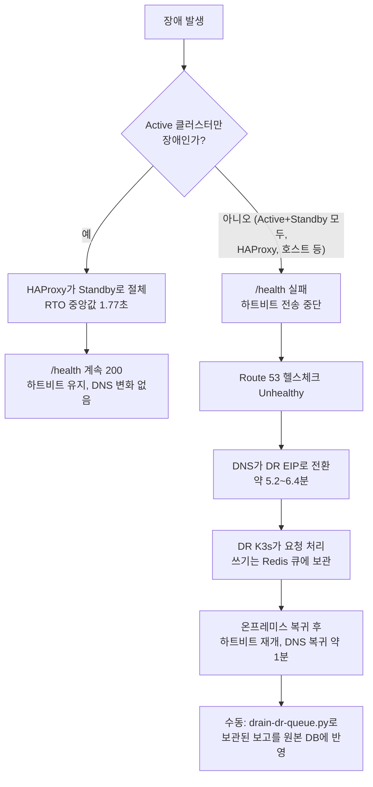
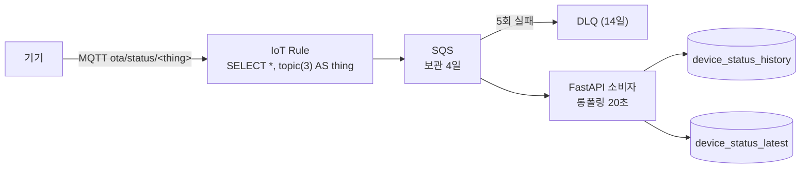

# 아키텍처와 설계 결정

이 문서는 [README](../README.md)의 구조를 구성 요소별로 풀어 쓰고, 왜 그렇게 설계했는지(그리고 어떤 한계가 있는지)를 정리합니다.
수치는 모두 [docs/evidence](evidence/README.md)의 원본에서 가져왔습니다.

## 1. 구성 요소

### 온프레미스 (Hyper-V + Multipass)
| 구성 | 역할 |
|---|---|
| **mgmt VM** | 컨트롤 타워. `docker compose`로 PostgreSQL 16(primary), Redis 7, HAProxy 2.9, Jenkins를 실행하고, 하트비트 에이전트와 Ansible 실행 지점을 겸함 |
| **K3s Active / Standby** | 각각 1노드 K3s. 같은 매니페스트(FastAPI 2 replicas, NodePort 30080)를 배포. DB와 Redis는 mgmt의 것을 공유 |
| **HAProxy (mgmt:8000)** | Active를 기본, Standby를 `backup`으로 두고 `GET /health`가 200인지 500ms 간격으로 확인(연속 실패 2회면 DOWN, 성공 2회면 UP) |

### AWS 도쿄
| 구성 | 역할 |
|---|---|
| **Route 53** | `ota.j1hoon.store`에 PRIMARY(온프레미스 IP, 헬스체크 연결)와 SECONDARY(DR EIP) 장애 조치 레코드. TTL 60초 |
| **CloudWatch** | `OTA/HybridDR` 네임스페이스의 `OnPremHeartbeat` 지표 |
| **DR VPC** | K3s EC2 1대(FastAPI, Redis 포함)와 PostgreSQL 복제본 EC2 1대. 보안 그룹은 K3s의 80(공개)과 DB의 5432(K3s에서만) |
| **IoT Core + SQS(+DLQ)** | 기기 MQTT 수신, 상태 메시지를 SQS로 전달 |
| **S3 + CloudFront** | 펌웨어 저장과 배포(OAC) |

### 소프트웨어
- **FastAPI**: `/health`(Redis 핑 + DB `SELECT 1`), `/ota/check`(조회), `/ota/report`(결과 보고), `/ota/publish`(API 키), `/ota/status/{device_id}`(API 키)
- **배포 방식**: GitHub Actions가 베이스 이미지를 ghcr.io에 빌드하고, 애플리케이션 코드(`main.py`)는 ConfigMap으로 마운트합니다. 이미지는 SHA 태그로 고정해서 재현성을 확보하고 롤아웃 시간을 줄였습니다.
- **Ansible**: 온프레미스는 `site.yml`, DR은 `dr.yml`로 분리했습니다. DR을 온프레미스 클러스터 목록(`ota_clusters`)에 넣지 않은 것은 `site.yml`이 DR을 온프레미스처럼 다루지 않게 하려는 의도입니다.

## 2. 장애 대응: 두 단계 방어

### 2.1 클러스터 수준: HAProxy 절체
- `haproxy_check_inter`는 절체 시간과 오탐 위험의 트레이드오프입니다. 10회씩 측정한 결과 RTO 중앙값은 `1000ms`에서 3.65초, `500ms`에서 1.77초, `250ms`에서 0.96초였습니다. 현재 값은 `500ms`입니다.
- 간격을 줄이면 절체는 빨라지지만 일시적 지연을 장애로 오판할 위험이 커집니다. `250ms`는 측정만 했고 채택하지 않았으며, 오탐 비교 데이터는 이 레포에 없습니다.
- 측정 방식: Active 노드의 NodePort를 iptables(raw 테이블)로 차단하고, mgmt에서 0.1초 간격으로 병렬 요청을 보내 Standby가 처음 200을 준 요청의 시작 시각으로 RTO를 계산합니다. 관측 지점은 mgmt이므로 실제 기기가 겪는 지연과는 다를 수 있습니다.

### 2.2 사이트 수준: 하트비트와 DNS
- **하트비트 에이전트**(mgmt)는 30초마다 `http://<mgmt>:8000/health`를 호출하고, **성공했을 때만** CloudWatch에 값 1을 보냅니다. 호출이 HAProxy를 거치므로, 클러스터 하나가 죽어도 Standby가 받아주는 한 하트비트는 유지됩니다.
- Route 53 헬스체크는 CloudWatch 알람이 아니라 `CLOUDWATCH_METRIC` 유형이고 `insufficient_data_health_status = "Unhealthy"`로 설정했습니다. 이 설정 전에는 지표가 끊겨도 `Healthy`로 남아 전환이 일어나지 않았습니다.
- **관찰**: 전환이 일어나는 동안 별도로 만든 CloudWatch 알람(주기 60초, 평가 3회)은 `OK`로 남았습니다. 그래서 Route 53이 알람이 아니라 지표 데이터를 직접 평가한다고 추정하지만, AWS 문서로 확인하지는 않았습니다.
- 전환 시간 약 5~6분의 구성 요인(하트비트 주기, 지표 집계, 헬스체크 평가, TTL 60초)별 기여도는 분해해서 측정하지 않았습니다.
- **플래핑 검증**: 2시간 동안 15초 간격으로 DNS를 조회했고(Jenkins 빌드를 돌리는 부하 상태) PRIMARY 이탈 0건(표본 478)이었습니다. 정상 운영 중 오탐으로 DR로 넘어가지 않는다는 것을 확인한 것입니다.
- **복귀**는 하트비트가 재개되면 자동으로 이뤄지고, 권한 서버 기준 33~80초였습니다. 공개 리졸버는 캐시 때문에 값이 불안정해서 복귀 시간은 권한 서버 기준만 신뢰합니다.

### 2.3 DR 종단 시나리오
세 가지 장애 유형에서 하트비트가 끊기고 DNS가 DR로 바뀐 뒤 요청이 DR에서 처리되는 것을 확인했습니다.

| 장애 | 호스트 | HAProxy | 에이전트 | 앱 |
|---|---|---|---|---|
| 에이전트 중단 | 정상 | 정상 | **중단** | 정상 |
| HAProxy 중지 (`l7`) | 정상 | **중지** | 정상 | 정상 |
| 앱 전부 중단 (`apps`) | 정상 | 정상 | 정상 | **전부 0 파드** |

모든 경우의 공통 원인은 `/health`가 성공하지 못하는 것입니다. 각 시나리오는 1회씩만 측정했습니다.

## 3. DR 환경 설계

- **K3s**: `--node-ip`는 VPC 사설 IP(`ens5`), `--disable traefik`. 관리용 kubectl만 Tailscale 주소를 씁니다. 데이터 경로가 Tailscale에 의존하지 않게 한 것입니다.
- **80번 포트**: EC2 `user_data`가 넣은 `80 → 30080` iptables REDIRECT를 제거하고 K3s ServiceLB(`type: LoadBalancer`)가 80을 직접 받게 했습니다. REDIRECT는 NAT 처리를 끝내서 이후의 NodePort 변환을 거치지 못할 것으로 판단했는데(규칙 순서에서 끌어낸 추정), 제거한 구성에서 정상 동작을 확인했을 뿐 REDIRECT가 실제로 충돌하는지는 되돌려서 확인하지 않았습니다.
- **Redis**: DR 클러스터 안의 Deployment(AOF, PVC)입니다. 온프레미스 Redis에 의존하지 않습니다.
- **DB**: `pg_basebackup -R` 기반의 스트리밍 복제본(읽기 전용, 비동기)입니다. 따라서 DR의 `/ota/check`는 복제본에서 읽고, `/ota/report`는 DB 쓰기가 실패하면 Redis 리스트 `ota:dr:report_queue`에 쌓습니다(응답 `QUEUED_IN_REDIS_AOF`).
- **상태 소비자(SQS)**: DR에서는 끕니다(`STATUS_QUEUE_URL` 빈 값). 온프레미스와 같은 큐를 동시에 소비하지 않기 위해서입니다.
- **접속**: SSH 키 페어 없이 Tailscale SSH와 SSM만 사용합니다.

### 복귀 후 데이터 반영
`scripts/drain-dr-queue.py`가 DR Redis의 큐를 읽어 원본 PostgreSQL에 반영합니다.
- `event_id`(없으면 원문 sha256)에 UNIQUE 인덱스를 두어 **멱등**입니다. 중간에 끊겨도 다시 실행하면 됩니다.
- 처리 못 하는 이벤트(예: `status` 제약 위반)는 `ota:dr:report_dead`로 옮기고 나머지를 계속합니다.
- 큐 삭제는 전부 처리한 뒤 읽은 개수만큼만(`LTRIM`) 해서, 처리 중 새로 들어온 이벤트를 건드리지 않습니다.
- `completed_at`은 DR이 접수한 시각을 쓰고, 기기 현재 버전은 더 새로운 이벤트일 때만 갱신합니다.
- 합성 데이터(중복, 잘못된 값, 인젝션 문자열)로 실제 PostgreSQL과 Redis에서 시험했습니다. 운영 환경에서는 이벤트 2건으로 확인했습니다.

## 4. 기기 상태 수집

- 소비자는 MessageId 기준으로 **멱등**이고, 테이블은 시작 시 `pg_advisory_xact_lock`으로 직렬화해 생성합니다(동시 `CREATE TABLE`의 충돌을 막기 위함).
- `topic(3)`을 기기 식별자로 신뢰하는 근거는 기기 정책이 자기 토픽에만 발행하도록 제한되어 있다는 점입니다.
- 유실 검증은 소비자 중단 시나리오 1회(3건 발행, 복구 후 3건 반영)입니다. DB 장애나 K3s 절체 중의 유실은 검증하지 않았습니다.

## 5. 비밀과 상태 관리

| 대상 | 방식 |
|---|---|
| Ansible 비밀 | Ansible Vault(`secrets.yml`, 레포에 없음) |
| Terraform 변수 | `TF_VAR_*` 환경변수. Terraform은 Vault를 읽지 못함 |
| Terraform state | S3 + KMS 고객 관리 키(자동 회전) + 버전닝(오래된 버전 90일 보관) + 퍼블릭 차단 + TLS 강제 + S3 네이티브 잠금. 버킷 생성은 `terraform/bootstrap`로 분리 |
| 접속 | 키 페어 없음(Tailscale SSH, SSM) |
| 레포 | `*.tfstate`, `*.tfvars`, `kubeconfig*`, `*.pem`, `secrets.yml`, `backend.hcl` 등을 ignore. 전체 이력에서 비밀 패턴 검색 결과 0건 |

- state에는 IAM 키와 디바이스 개인키가 들어 있습니다. 암호화는 저장 매체가 유출될 때만 보호하고, AWS 권한이 있는 주체가 state를 읽는 것은 막지 못합니다. state를 읽을 수 있는 IAM 주체를 최소화하는 것이 다음 과제입니다.
- 원격 state 전환 후 `terraform plan`이 `No changes`임을 확인했습니다. 잠금은 동시 실행 시 S3가 `412 PreconditionFailed`로 거부하는 것을 한 번 관찰했습니다(출력은 계정 ID가 있어 레포에 보관하지 않음).

## 6. 알려진 한계

[README의 한계 항목](../README.md#4-증명하지-못한-것-한계)과 같습니다. 가장 중요한 것은 (1) 실제 인터넷 트래픽 경로 미검증, (2) DR 시나리오의 1회 측정, (3) RPO 미측정, (4) 복귀 후 데이터 반영이 수동이라는 점입니다.
